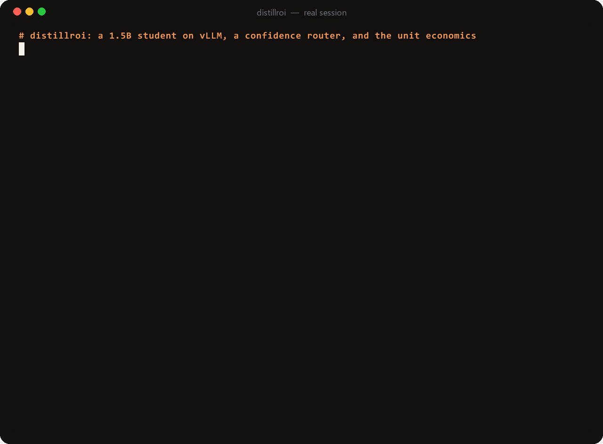
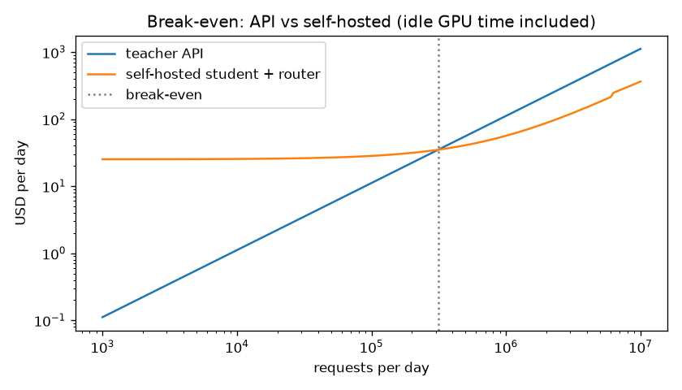
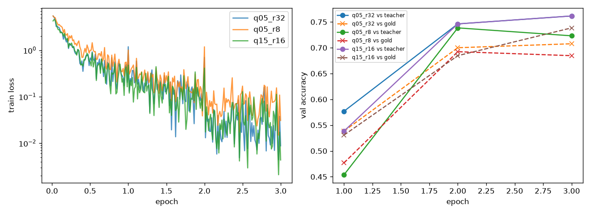
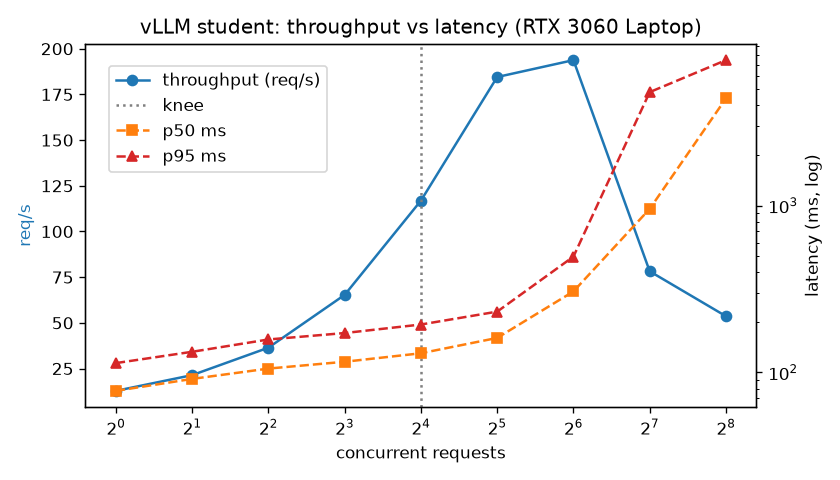
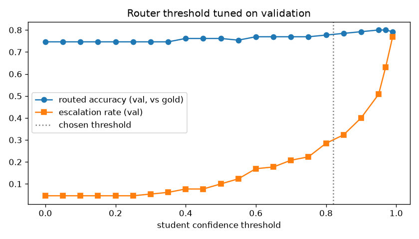
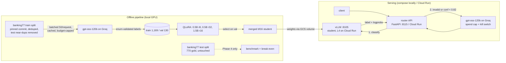

<p align="center">
  <picture>
    <source media="(prefers-color-scheme: dark)" srcset="assets/brand/logo-dark.svg">
    
  </picture>
</p>

<p align="center">
  <b>Distill a frontier-model task into a small open model, and prove the unit economics.</b><br>
  A 1.5B QLoRA student on vLLM reaches 90% of a 120B teacher's accuracy; a confidence router that escalates
  28% of traffic gets 99.7%. Above ~313K requests/day it is cheaper than the API.
</p>

<p align="center">
  
  <br><sub>A real session against the local vLLM + router stack (teacher calls off; escalations show the cached teacher answer). <a href="assets/demo/README.md">How it was recorded</a>.</sub>
</p>

<p align="center">
  <a href="https://github.com/niravpatidar37/distillroi/actions/workflows/ci.yml"></a>
  <a href="LICENSE"></a>
  
</p>

> **Status: working MVP, measured on a laptop.** Every number below comes from a committed result file. The scale
> is small (1,300 teacher-labelled training queries, a 6 GB RTX 3060 Laptop, prices are list-price estimates), and
> the cloud deployment is **deploy-ready but not applied** (no cloud account connected). Read
> [what did not work](#what-did-not-work--limits-honest) before reusing the numbers.

## The problem

Calling a frontier model for every request of a narrow, high-volume task (intent classification, extraction,
routing) is easy to ship and expensive to run. The usual answers each leave a question open:

- **Distillation** trains a small model on the big model's outputs ([Hinton et al., 2015](https://arxiv.org/abs/1503.02531)).
  Small task-specific students can match or beat few-shot LLMs ([Hsieh et al., 2023](https://arxiv.org/abs/2305.02301):
  a 770M T5 outperforms few-shot 540B PaLM on a benchmark), but *how much* of the teacher you keep on *your* task
  is an empirical question.
- **Cascades and routers** send only hard queries to the expensive model. FrugalGPT reports matching GPT-4 with up
  to 98% cost reduction ([Chen et al., 2023](https://arxiv.org/abs/2305.05176)); RouteLLM reports over 2x savings
  without quality loss in some cases ([Ong et al., 2024](https://arxiv.org/abs/2406.18665)). The answer depends on
  your escalation rate.
- **Self-hosting** a GPU is a fixed cost paid whether it is busy or idle, so it is only cheaper above some volume.
  Most write-ups report accuracy, or cost, or latency, rarely all three on the same test set with the break-even.

distillroi measures all three axes end to end on one real task and gives the volume at which the student pays off.

## What it does

| Stage | What happens | Where |
|---|---|---|
| **Data** | banking77 (77 intents) from a pinned commit, near-duplicate dedupe, test-leakage filter, a frozen 770-query stratified test set that is not touched until the benchmark | `scripts/prepare_data.py`, `src/distill/data.py` |
| **Teacher labels** | gpt-oss-120b on Groq labels training queries in batches of 50; every label is validated against the 77-label enum; cached by content hash, resumable, behind a hard spend cap | `scripts/run_teacher.py`, `src/distill/teacher.py`, `src/distill/spend.py` |
| **Student** | QLoRA (nf4, bf16 compute, all-linear LoRA) on Qwen2.5 0.5B/1.5B; selection on validation only; merged bf16 weights | `scripts/train.py`, `scripts/select_student.py`, `scripts/eval_student_hf.py` |
| **Serving** | vLLM (pinned by digest) on 127.0.0.1:8105; confidence = joint probability of the generated label tokens from vLLM logprobs | `docker-compose.yml`, `src/distill/student.py` |
| **Router** | FastAPI `POST /v1/classify`: student first; escalate to the teacher when the output is not a valid label or confidence < threshold (0.82, tuned on validation); kill switch `TEACHER_ENABLED=false` | `src/distill/router.py`, `src/distill/app.py` |
| **Economics** | one benchmark with accuracy, $/1K requests and latency for teacher, student and routed system, plus the break-even volume V* | `scripts/report.py`, `src/distill/costs.py`, `results/benchmark.json` |

## Results (three axes, one table)

All numbers come from files in `results/` (`benchmark.json`, `benchmark.md`, `router_eval.json`, `router_live.json`,
`vllm_sweep.json`, `teacher_online_bench.json`). Test set: banking77 **test split**, stratified 10 per class = 770
queries, gold labels, not touched until Phase 4.

| System | Accuracy (test, n=770) | Macro-F1 | $ / 1K requests | p50 / p95 latency @ c=1 | p50 / p95 @ c=4 |
|---|---|---|---|---|---|
| Teacher: gpt-oss-120b on Groq (1 query/request) | 81.2% | 0.801 | $0.111 (paid list price) | 443 / 566 ms | 417 / 874 ms |
| Student: q15_r16 on vLLM | 73.2% (90.2% of teacher) | 0.733 | $0.025 at 1M/day; $0.25 at 100K/day (idle included) | 78 / 114 ms | 105 / 158 ms |
| Routed: student -> teacher if conf < 0.82 | 80.9% (99.7% of teacher) | 0.795 | $0.056 at 1M/day (escalation 28.1%) | live end-to-end at c=2: 568 / 1708 ms (all requests) | see c=1 column |

The routed row's latency comes from the live run below, which happened with the laptop on battery (GPU capped at
30 W): a direct vLLM call then took ~0.66 s instead of the 78 ms p50 measured in the sweep (`results/router_live_power_state.txt`).
It is reported as measured, not corrected.

- **Cost**: the teacher is priced at Groq's paid list rate ($0.15 / $0.60 per 1M input/output tokens) for a measured
  586.9 input + 39.0 output tokens per online request. The student is a Cloud Run L4 instance at **$1.047/hour
  including 4 vCPU + 16 GiB** (estimate from https://cloud.google.com/run/pricing, verify before use), billed 24 h/day
  whether busy or idle, with instances sized to 60% of the measured knee throughput.
- **Latency**: teacher = wall time of one Groq request; student = one vLLM request from the Windows host through Docker
  Desktop/WSL2 port forwarding on an RTX 3060 Laptop (6 GB). Comparable concurrency means the same number of
  in-flight requests; the teacher at c=4 is nominal because the free-tier token bucket serialises calls.
- **Full test split (3,080)**, student only (free to run): 74.3% accuracy, macro-F1 0.743 (`results/served_metrics.json`).

### Break-even volume

```
V* = 24 * H / ((1 - e) * c_t)
H   = $1.0465 / GPU-instance-hour (Cloud Run L4 + 4 vCPU + 16 GiB, estimate)
c_t = $0.000111 per teacher request (measured tokens x Groq paid price)
e   = 0.281 escalation rate (threshold tuned on validation, measured on test)
V*  = 225,467 requests/day for a student with no fallback
V*  = 313,375 requests/day for the routed system (escalations still pay the teacher)
```

One instance serves ~6.1M requests/day at 60% of the measured knee (117 req/s), so V* fits on a single always-on
instance; `costs.instances_needed` only adds a second instance above ~6M/day. Below ~313K requests/day the API is
cheaper; at 1M/day the routed system costs $0.056 per 1K requests vs $0.111 for the teacher (about half), and the
student alone $0.025 (about 1/4.4). 

### Training runs (Phase 3)

Three QLoRA configurations (nf4 4-bit base, bf16 compute, all-linear LoRA, lr 2e-4 cosine, 3 epochs, effective batch
16), trained on 1,169 teacher-labelled queries, validated on 130. Selection used **validation only** (accuracy vs
teacher labels, tie-break macro-F1). Test columns are report-only, computed after selection.

| Config | Base | LoRA r | Trainable params | Best epoch (val) | Val acc vs teacher | Val macro-F1 vs teacher | Train time | Peak VRAM allocated / reserved | Spilled to shared RAM? | Test-770 acc (report only) |
|---|---|---|---|---|---|---|---|---|---|---|
| q05_r8 | Qwen2.5-0.5B-Instruct | 8 | 4.4M | 2 | 73.8% | 0.660 | 203 s | 1.02 / 1.74 GB | no | 61.8% |
| q05_r32 | Qwen2.5-0.5B-Instruct | 32 | 17.6M | 3 | 76.2% | 0.692 | 205 s | 1.13 / 1.86 GB | no | 72.1% |
| **q15_r16 (served)** | Qwen2.5-1.5B-Instruct | 16 | 18.5M | 3 | 76.2% | 0.721 | 265 s | 1.83 / 2.20 GB | no | 73.2% |
| qwen7b_r16 | Qwen2.5-7B-Instruct | 16 | - | - | - | - | **not run** (config for a rented 24 GB GPU) | - | - | - |

Logged per step (loss, LR) and per epoch (val loss, val accuracy/macro-F1 vs teacher and vs gold, invalid-output rate,
8 sample outputs) to `results/train/<config>/{steps.csv,epochs.csv,samples.json,summary.json}` and to W&B in offline
mode (`wandb/`, gitignored; `wandb sync wandb/offline-run-*` to upload). Rank 8 peaked at epoch 2 and slipped at
epoch 3 (73.8% -> 72.3% val acc vs teacher), the overfitting signal the guide warns about; rank 32 and the 1.5B model
were still improving at epoch 3. 

**GPU memory (6 GB card).** The first 1.5B smoke run allocated a peak of 11.9 GB on a 6.44 GB card, which is only
possible through the Windows WDDM shared-memory fallback, and took 436 s for 32 steps. After the fixes (logits for
the label tail only, gradient checkpointing, paged 8-bit AdamW, micro-batch 8 x accumulation 2, KV-cache greedy eval)
and an allocator cap at 5.4 GB (`torch.cuda.set_per_process_memory_fraction`, so a config that does not fit fails
with OOM instead of spilling), the same run peaked at 1.83 GB allocated and took 42 s
(`results/vram_spill_evidence.json`). Every training summary records `peak_reserved_gb` and `spilled_to_shared_memory`.

### Serving (Phase 5): throughput vs concurrency

vLLM v0.31.0 (pinned by digest) in Docker Desktop with the GPU, serving the merged q15_r16 student on
127.0.0.1:8105 (bf16, max-model-len 512, gpu-memory-utilization 0.70). Load = real banking77 training-split queries
never used for training or evaluation.

| Concurrency | 1 | 2 | 4 | 8 | **16 (knee)** | 32 | 64 | 128 | 256 |
|---|---|---|---|---|---|---|---|---|---|
| req/s | 12.8 | 21.4 | 36.4 | 65.3 | **116.9** | 184.5 | 193.8 | 78.2 | 53.6 |
| p50 ms | 78 | 91 | 105 | 116 | **130** | 161 | 306 | 955 | 4,384 |
| p95 ms | 114 | 133 | 158 | 172 | **194** | 231 | 494 | 4,781 | 7,435 |

Knee rule: the highest concurrency whose p95 stays within 2x the single-stream p95 -> **c=16, 117 req/s**. Throughput
saturates at ~190 req/s (c=32-64) and collapses beyond (2 request errors each at c=128 and c=256). The 0.5B r32
student (`results/vllm_sweep_q05_r32.json`) does 343 req/s at c=32 with p95 146 ms but collapses at the same c=64-128,
so the collapse is probably the host-side path (Windows client -> WSL2 port forward), not the GPU; this was not
isolated. 

### Router (escalation path)

Student first; escalate to the teacher when the student's output is not one of the 77 labels or its confidence (joint
probability of the generated label tokens, from vLLM logprobs) is below a threshold. The threshold is the lowest-
escalation value whose routed **validation** accuracy reaches 99% of the teacher's: **0.82** (val: 78.5% routed vs
79.2% teacher, 29.2% escalation). Applied once to test: 28.1% escalation (33 invalid outputs + 183 low-confidence of
770), 80.9% routed accuracy. Offline test routing reuses the teacher's Phase-1 answer for each escalated query.


**Live escalation path** (`results/router_live.json`): 40 test queries sent through the running router container
(student on vLLM, real Groq escalations, concurrency 2): **12.5% escalated** (5/40, all to real teacher calls), routed
accuracy 85.0% on this small sample, student accuracy on the 35 accepted queries 85.7%. Escalated requests took
p50 1.66 s / p95 2.18 s end to end; student-only requests p50 0.52 s / p95 1.02 s, inflated by the 30 W battery GPU
cap noted above. 14 escalations first hit Groq's free-tier daily-token limit; the router correctly degraded to the
student's answer and the measurement script waited 150 s and resent them, so every escalation counted here is a
real teacher answer. Teacher spend for the run: $0.00057 ($0.014 per 1K routed requests). The 40-query sample's
12.5% escalation is lower than the 28.1% measured on all 770 test queries; the larger number is used for costs.

## Quick start

Requirements: Python 3.12 via [uv](https://docs.astral.sh/uv/), a CUDA GPU (6 GB is enough), Docker Desktop with GPU
support, and a Groq key in `F:/.secrets/portfolio.env` (or the file named by `PORTFOLIO_ENV_FILE`). Variable names
are in [`.env.example`](.env.example); never commit values.

**Run the router against a student you already trained** (weights are never in git; `artifacts/` is ignored):

```bash
STUDENT_MODEL_DIR=./artifacts/merged/q15_r16 ROUTER_THRESHOLD=0.82 docker compose up -d --build
curl -s 127.0.0.1:8115/readyz
curl -s -X POST 127.0.0.1:8115/v1/classify -H 'content-type: application/json' \
  -d '{"text": "I want to return an item."}'
# -> {"label": ..., "source": "student" | "teacher" | "student_degraded", "reason": ..., "student_confidence": ..., "latency_ms": ...}
docker compose down
```

Set `TEACHER_ENABLED=false` to run with no paid calls at all (escalations then return the student's answer as
`student_degraded`, or 503 when the student's output is not a valid label).

**The whole pipeline**, end to end:

```bash
uv sync --extra train                                       # torch cu128, transformers, peft, bitsandbytes, wandb
uv run python scripts/prepare_data.py                       # banking77 (pinned), dedupe, frozen test subset
uv run python scripts/run_teacher.py --split test           # Phase 1: teacher ceiling on the 770 test queries
uv run python scripts/run_teacher.py --split pool --limit 5000 --wait-hours 12   # Phase 2 (resumable, cached)
uv run python scripts/build_splits.py                       # freeze train/val BEFORE tuning
for c in q05_r8 q05_r32 q15_r16; do uv run python scripts/train.py configs/train/$c.yaml; done
uv run python scripts/select_student.py                     # pick on val
uv run python scripts/eval_student_hf.py q15_r16 --merge --split val --split test_770 --split test_full
STUDENT_MODEL_DIR=./artifacts/merged/q15_r16 ROUTER_THRESHOLD=0.82 docker compose up -d --build
uv run python scripts/bench_vllm.py predict --split val --split test_770 --split test_full
uv run python scripts/bench_vllm.py sweep
uv run python scripts/router_eval.py                        # threshold on val, applied once to test
uv run python scripts/bench_teacher.py --n 10 --concurrency 1 --concurrency 4
uv run python scripts/live_router.py --n 40 --concurrency 2 --offset 100
uv run python scripts/report.py                             # benchmark.json/.md + plots
uv run pytest -q                                            # CI subset; -m gpu / -m integration locally
docker compose down
```

## Architecture



### Design decisions

1. **1.5B student instead of the guide's 8B.** The 6 GB laptop GPU trains 0.5-1.5B QLoRA without spilling; an 8B
   config is committed (`configs/train/qwen7b_r16_rented_gpu.yaml`) for a rented 24 GB GPU but was not run. The
   trade-off showed up in serving: the 1.5B is +1.1 points on test but about half the 0.5B's throughput (117 vs 240
   req/s at c=16). Because one instance already covers the break-even volume, the break-even number does not change;
   capacity per dollar does.
2. **Generative label + logprob confidence instead of a classification head.** It keeps vLLM's OpenAI API, continuous
   batching and prefix caching (the system prompt is shared), and the joint label probability gives the router a
   usable confidence signal. Cost: ~4% of outputs are not valid labels and must escalate.
3. **Teacher labels, not gold, for training.** That is the distillation setting, and it caps the student: the teacher
   agrees with gold on only 80.2% of its own training labels, so a perfect copy of the teacher would score ~81%.

## Security model

Threat model: callers send untrusted text; both models' outputs are untrusted; the teacher key and spend are assets.

| Control (in code) | Where | Test that fails if removed |
|---|---|---|
| Closed-enum output validation (teacher and student); anything else = invalid -> escalate/drop | `labels.canonical_label`, `teacher.parse_batch` | `test_parse_batch_validates_every_label_against_enum`, `test_student_client_maps_raw_text_to_enum_or_none` |
| Spend cap checked **before** each paid call (shared JSONL ledger, file lock, worst-case estimate) | `spend.SpendLedger`, `teacher._chat` | `test_spend_cap_refuses_before_any_network_call` |
| Kill switch `TEACHER_ENABLED=false` | `router.Router` | `test_kill_switch_blocks_all_teacher_calls` |
| Input bounds (1-500 chars, non-blank), single-line prompt formatting | `app.ClassifyRequest`, `labels.clean_query` | `test_api_rejects_oversized_and_blank_input` |
| Optional bearer auth with constant-time compare (Cloud Run: IAM invoker) | `app.auth` | `test_api_requires_bearer_when_key_configured` |
| No query text in logs (hash + length), PII/secret redaction in JSON logs | `logs.py` | `test_api_logs_never_contain_query_text`, `test_redact_masks_pii_and_secrets` |
| Service-to-service ID token from a fixed metadata URL (no SSRF surface) | `student.GcpIdTokenSource` | `test_student_client_attaches_cached_gcp_id_token` |
| Groq org id redacted from quota errors | `teacher._chat` | `test_429_tpm_is_retried_but_tpd_stops` |

**Residual risk:** prompt injection can still change which (valid) label is returned; the enum bounds the blast
radius to a misclassification. Teacher responses are used for nothing but a label. On Cloud Run the spend ledger is
per instance (see limits), so the global cap is split, not exact.

OWASP LLM Top 10 (2025): LLM01 prompt injection -> enum-bounded output, "data, not instructions" prompt; LLM02
sensitive information disclosure -> no query text in logs, redaction; LLM03 supply chain -> pinned model revisions,
image digests, `uv.lock`, pip-audit, trivy; LLM04 data poisoning -> teacher labels validated against the enum,
dedupe, test-leakage filter; LLM05 improper output handling -> strict validation, no model output executed or
rendered; LLM06 excessive agency -> no tools; LLM10 unbounded consumption -> spend cap, token-rate limiter, input
length cap, kill switch, Cloud Run max instances.

Report vulnerabilities privately: [SECURITY.md](SECURITY.md).

## What did not work / limits (honest)

- **Too few teacher labels.** 1,300 instead of 5-10K: Groq's free tier refills its daily token bucket at roughly
  10-12K tokens/hour, so it behaves like a slowly refilling bucket, not a midnight reset. Several classes have only
  2-5 training examples. Labelling is resumable (`scripts/run_teacher.py --split pool --limit 5000 --wait-hours 12`);
  with more labels the student should improve.
- **The student is not in the "mid-nineties of teacher".** 90.2% of teacher accuracy; the router closes the gap by
  sending 28% of traffic to the teacher, which halves rather than eliminates the API bill at high volume.
- **Rank 8 underfits** (61.8% test): too little capacity for 77 classes from 1.2K examples.
- **Saturation beyond c=64** on this box; the cause (host networking vs GPU) was not isolated.
- **Latency/throughput are from a laptop GPU through WSL2**, then priced at L4 rates. An L4 is faster with 4x the
  memory, so the cost side is conservative, but the numbers are not Cloud Run measurements.
- **The teacher latency sample is small** (10 requests per concurrency level) because of the token quota.
- The spend ledger on Cloud Run is local to each instance (cap split across `router_max_instances`); a shared ledger
  (e.g. Firestore/Redis) would be needed for an exact global cap.

## Cost of this build (ledger)

Total teacher spend for this project, read from the shared ledger (`F:/.llm-spend/ledger.jsonl`, project
`p5-distill`), priced at Groq's paid rate: **$0.040** for 68 paid calls (70,606 input + 49,016 output tokens):
teacher ceiling on 770 test queries ($0.014), labelling 1,300 training queries ($0.020 + two earlier batches), the
online latency benchmark ($0.002) and the live router run ($0.0006). The key used is free tier, so the actual
charge was $0. GPU: local laptop, $0. Recording the demo GIF made no paid calls (teacher disabled). Estimate before
launch: a 50-query probe used 35 tokens per query; the full test run averaged 49 tokens per query (more reasoning
tokens), about $0.000018 per labelled query.

## Deployment

Status: **deploy-ready; not applied (no cloud account connected).** Target: Cloud Run with an NVIDIA L4 for the vLLM
student (`nvidia.com/gpu = 1`, `node_selector.accelerator = "nvidia-l4"`, `gpu_zonal_redundancy_disabled`, validated
against hashicorp/google 8.7.0) and a separate CPU Cloud Run service for the router. Weights come from a GCS bucket
mounted read-only (never fetched from the internet at request time); the Groq key lives in Secret Manager.

- IaC: `infra/terraform/modules/distill` + `envs/{staging,prod}` (GCS backend via `-backend-config`, lock file committed).
- CI (`.github/workflows/ci.yml`): ruff, mypy, pytest, bandit, pip-audit, gitleaks, docker build + non-root/health
  checks + trivy, terraform fmt/validate, tflint, checkov, trivy config. No secrets, no GPU (GPU/integration tests
  are marked and skipped).
- CD (`.github/workflows/deploy.yml`): build -> Artifact Registry -> staging -> smoke -> manual `production` approval
  -> candidate tag -> 10% canary -> 100%, automatic rollback; keyless WIF; images by digest. All jobs skip until
  repo variables `GCP_PROJECT_ID`, `GCP_REGION`, `GCP_WIF_PROVIDER`, `GCP_DEPLOY_SA` are set.
- One-time GCP bootstrap (WIF pool bound to `niravpatidar37/distillroi`, deployer SA, repo variables), rollback, key
  rotation, kill switch: [docs/RUNBOOK.md](docs/RUNBOOK.md). SLOs and monthly cost (~$764/month per always-on L4
  instance, estimate): [docs/SLO.md](docs/SLO.md).
- No database, so no migrations; the service is stateless apart from the spend ledger.

## Project layout

```
src/distill/          the package: data, labels, teacher (Groq), student (vLLM client), router, FastAPI app,
                      costs (break-even), spend ledger, metrics, settings, JSON logs with redaction
scripts/              pipeline steps: prepare_data, run_teacher, build_splits, train, select_student,
                      eval_student_hf, bench_vllm, router_eval, bench_teacher, live_router, report
configs/train/        QLoRA configs (q05_r8, q05_r32, q15_r16, and the unrun 7B config)
data/processed/       banking77 splits + teacher-labelled pool (CC-BY-4.0); raw downloads and caches are ignored
results/              every number in this README (benchmark, router, sweeps, training logs, predictions)
docs/                 RUNBOOK.md, SLO.md, plots in docs/img/
infra/terraform/      Cloud Run module + staging/prod envs
assets/brand/         logo, icon, favicon, social preview, built by assets/brand/tools/build_brand.py
assets/demo/          demo.gif and the recorder that produced it (record.py, ask.py, summary.py, frame.py)
tests/                pytest: data, teacher, router/API security controls, cost maths (GPU tests marked)
```

## Resume line

Distilled a frontier-model task (gpt-oss-120b, 77-way banking intent classification) into a 1.5B QLoRA student at
90% of teacher accuracy (99.7% with a confidence router escalating 28% of traffic) at about 1/4 of the per-request
cost at 1M requests/day; served with vLLM, with break-even at ~313K requests/day.

## License and data

Code: [MIT](LICENSE). Data: banking77 (Casanueva et al., 2020, [arXiv:2003.04807](https://arxiv.org/abs/2003.04807)),
CC-BY-4.0, from PolyAI-LDN/task-specific-datasets at commit 57ec275. Brand assets: see
[assets/brand/README.md](assets/brand/README.md). Contributions: [CONTRIBUTING.md](CONTRIBUTING.md).
